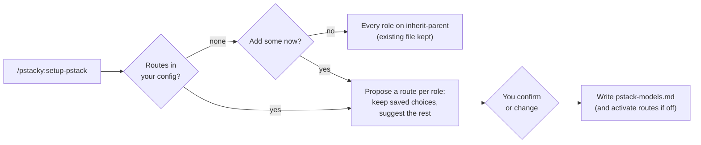
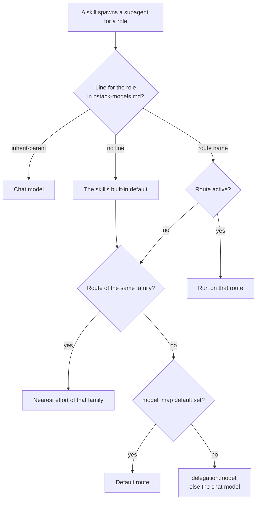

# pstacky

pstack for Hermes Agent, 1:1. Every upstream skill ships byte for byte, with one
adapter line that maps Cursor's tool names to Hermes, plus `deslop` from
`cursor-team-kit`. It works with the default single-model delegation and with
`advanced-delegation`'s `model_map` routes.

Upstream: [cursor/plugins `pstack`](https://github.com/cursor/plugins/tree/main/pstack),
MIT, © Lauren Tan. See `NOTICE`.

## Install

```sh
hermes plugins install Trisert/pstacky --enable --force
```

`--force` is required. The install scanner blocks every community package with a
caution verdict, and pstacky always gets one: upstream `statechart` ships test
fixtures with invisible Unicode and dense string parsing, which the scanner reads
as obfuscation. pstacky runs no code on install. Read the findings before you
pass `--force`; `--force` applies to this one install only.

Install into a profile with `hermes -p <profile> plugins install ...`.

Skills land in the plugin namespace: `/pstacky:poteto-mode`,
`/pstacky:interrogate`, `/pstacky:swarm`, `/pstacky:deslop`, and the rest.

## Use

- `/pstacky:poteto-mode <task>` runs the orchestrator, which picks a playbook.
- `/pstacky:interrogate <scope>` runs an adversarial review. Findings need a
  reproducing run.
- `/pstacky:deslop` removes AI slop from the current diff before a commit.

A skill reads `../../docs/harness/hermes.md` once per session. That file is the
single adapter for the whole package.

## Models

pstacky ships no model ids. Every model is your choice, and you can change it at
any time.

### How it works

pstack's skills spawn subagents by role (`bug-fix`, `arena runners`,
`interrogate reviewers`, ...). Each role runs on a **route** you define, or on
the chat's own model (`inherit-parent`).

- **Routes** live in your Hermes config, under `advanced-delegation`'s model
  map: a name, a one-line description, a provider and a model.
- **Roles** live in `$HERMES_HOME/pstack-models.md` (`~/.hermes` without a
  profile): one line per role. A single-model role takes one value; a panel
  role (`arena runners`, `interrogate reviewers`) and `arena cross-judge pool`
  take a comma-separated list, one entry per seat or judge candidate. Each
  value is a route name or `inherit-parent`.

Without routes, every role runs on `delegation.model` when it is set, else on
the chat model. Panels still fan out N subagents with different framings, and
the cross-vendor judge is skipped.

### Upstream defaults, and what to pick instead

pstack (Cursor) ships three models, each with a job:

| Job | Upstream default | Roles |
| --- | --- | --- |
| Main worker | Claude Opus 5.5 | feature, bug-fix, perf, hillclimb, judgment, swarm; a panel seat; first judge candidate |
| Second opinion | Claude Fable 5.2 | a panel seat in arena and interrogate |
| Another vendor | Gemini 4 Neon | a panel seat; second judge candidate |

The model names matter less than the jobs: panels want different points of view,
and the judge must come from a different vendor than the chat model. Arena takes
the first judge candidate that qualifies, so with a Claude chat model Gemini
judges. Pick the
equivalents you have. Some examples, not recommendations:

| Provider | Main worker | Second opinion | Another vendor |
| --- | --- | --- | --- |
| Anthropic + Google | Opus | Fable | Gemini |
| ChatGPT / Codex only | a GPT "sol" model | a GPT "astra" model | none: the judge is skipped |
| OpenCode Go | DeepSeek V4.1 Flash | Kimi K3.1 Pro | Gemini, GLM, Qwen, ... |

### Set it up

1. `hermes plugins install advanced-delegation --enable`.
2. `hermes delegation config` in a shell, mode Model routes. Add one route per
   model you want to use, cheapest first, each with a one-line description of
   what it is good at. Name a route after the model it runs, then its effort
   (`deepseek-xhigh`, `kimi-high`, `sol-high`). Give two different models two
   different names, not the same family with different efforts.
3. Run `/pstacky:setup-pstack` once. For every role still on
   `inherit-parent` it suggests one of your routes, based on the descriptions;
   for a panel (arena runners, interrogate reviewers) it suggests a different
   route per seat when you have enough. You confirm or change each one. The
   role file is written only with your yes. setup-pstack can do steps 1 and 2
   for you in the same run if you ask.

You do not need Claude or Gemini. Only if you already run them: a route named
for its family (`opus-*`, `fable-*`, `gemini-*`) is mapped to that model's
default roles on its own, and you still confirm the table. Never name a route
`opus-*` unless it runs Opus.

The playbooks and agent files also name Claude models as defaults
(`claude-opus-5-5-xhigh-fast` for code work, for example). They read your role
line first, so a role in `pstack-models.md` always wins. A step with no role
line, such as eval's dispatcher or poteto-agent's own default, keeps its Claude
default: it runs on a route of that family if you have one (`opus-medium` for
eval's dispatcher), else on the model map's `default` route, else on
`delegation.model` or the chat model. Without Claude routes, point `default` at
your main worker.

### How setup-pstack decides

You run it once. The role file it writes is used by every later session; rerun
it only to change your choices.



It asks for a budget only when one model has routes at several efforts; with one
route per model there is nothing for a budget to move.

setup-pstack never changes your config or installs anything without your yes,
and never invents a model id.

### How a role picks its model



### Change a model later

- **Same role, different model:** point the route at the new model in
  `hermes delegation config`. Every role that uses the route follows it.
- **One role only:** edit its line in `pstack-models.md`, or rerun
  `/pstacky:setup-pstack` and change it at the confirm step.
- **Back to the default:** delete the role's line.

Route changes apply to new sessions. A role naming a route that no longer
exists maps to the nearest route of the same family, else runs unrouted (the
model map's default route, or the chat model) and says so.

## What is not shipped

- `make-bot-ui`: its Tailscale step pipes a downloaded installer into a root
  shell, which the plugin install scanner treats as privilege escalation.
- `automations/benny`, upstream `assets/`, `.cursor-plugin/`: Cursor-only.

Upstream text is otherwise unchanged. There are two kinds of edit:

- The adapter line after the first heading (or after frontmatter when a skill
  has no heading), in every skill except `deslop`.
- Links. A relative link to a file pstacky does not ship (`make-bot-ui`,
  `automations/benny`, `docs/harness/claude-code.md`) points at the pinned
  GitHub copy, and `blob/main` links are pinned to the same commit. This touches
  `poteto-help/SKILL.md` and guide pages 1, 7 and 9. In `poteto-help`, the
  `../../README.md` link now opens this README, which is the right install
  guide for Hermes.

## Layout

```
plugin.json            manifest (agent-plugins v1)
skills/<name>/         upstream skill, one adapter line
skills/<name>/references/agents/  only the agent that skill spawns
skills/deslop/         companion skill, no adapter line
agents/                poteto-agent.md, comment-sicko.md
docs/harness/hermes.md adapter source of truth
docs/guide/            upstream guide
tools/                 generate.py, validate.py, terms.py, vendor.sh
UPSTREAM_PIN           repository, commit, upstream version
```

## Development

```sh
tools/vendor.sh                     # clone cursor/plugins at UPSTREAM_PIN
python3 tools/generate.py           # rebuild skills/, agents/, docs/guide/, plugin.json
python3 tools/generate.py --check   # fail on drift (CI)
python3 tools/validate.py           # package contract
python3 -m unittest discover -s tests -q   # tests (stdlib, no deps)
```

Bump the pin: edit `UPSTREAM_PIN`, re-run `tools/vendor.sh`, `generate.py`,
`validate.py`. The build is deterministic; the generated tree is committed.

## Licence

MIT. `LICENSE` covers the packaging, adapter and tools; upstream pstack and
`deslop` are MIT, © 2026 Lauren Tan, attributed in `NOTICE`.
